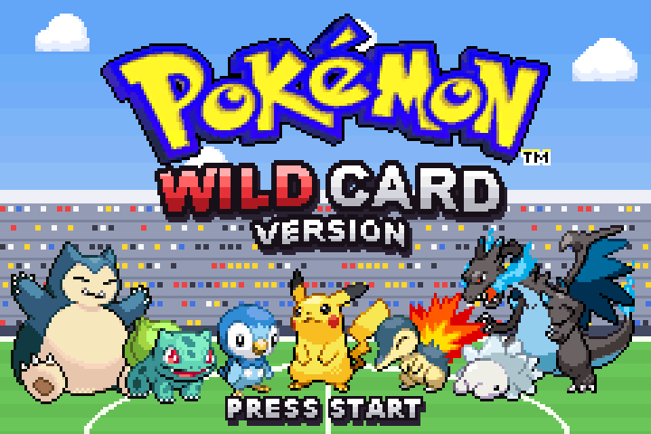
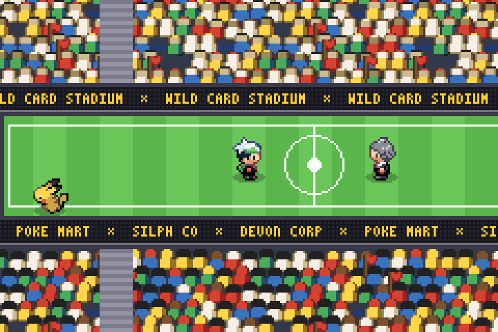
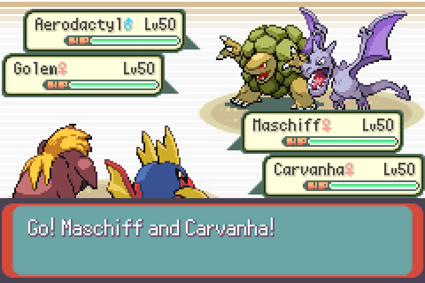

<p align="center">
  
</p>

<h1 align="center">Pokémon Wild Card</h1>

<p align="center">One opponent a day. One random team of six. One try.</p>

<p align="center">
  <!-- TODO: the site's address once it's live -->
  <a href="#play"><b>Play in your browser</b></a> &nbsp;·&nbsp;
  <a href="https://github.com/thecavemanjon/wildcard/releases/latest"><b>Download the patch</b></a>
</p>

> [!CAUTION]
> **You need your own copy of Pokémon Emerald.** Wild Card is a patch, and it only
> works on an English Pokémon Emerald ROM dumped from a cartridge you legally own.
> This project contains no ROMs and will never link to one, so please don't ask for
> one in issues.

<table>
  <tr>
    <td></td>
    <td></td>
    <td></td>
  </tr>
</table>

Wild Card is a daily Pokémon battle built on Pokémon Emerald. The date picks your
opponent and gives you six random Pokémon at level 50. You get one attempt, and
everyone playing that day gets the same opponent and the same six, so you can
compare results with friends.

## Play

**In your browser.** Open the site, pick your Emerald ROM once, and press Play. The
page patches it in your browser and keeps it there with your save; nothing is
uploaded. Phones get on-screen buttons.

**In an emulator.** Download `wildcard.bps` from
[Releases](https://github.com/thecavemanjon/wildcard/releases/latest) and apply it
to your Emerald with [Rom Patcher JS](https://www.marcrobledo.com/RomPatcher.js/)
or Flips. Play the result in an emulator that runs Emerald's clock, such as mGBA:
the date your device reports is the date you play. A clean English Emerald has the
SHA-1 `f3ae088181bf583e55daf962a92bb46f4f1d07b7`.

## What's in it

- **The daily battle.** Gym leaders early in the week, the Elite Four midweek,
  Maxie, Archie or Giovanni on Fridays, a rival on Saturdays and Wallace or Steven
  on Sundays. Win and your streak goes up; the results card is yours to share.
- **Rule days and event days.** Some dates add a twist (a terrain, Trick Room, an
  inverse type chart), and Halloween, Christmas and Easter bring their own battles.
- **The gauntlet.** A weekly run through a Kanto league: draft three of six, swap in
  one of theirs after a win if you like, and find Red at round ten. Reach round five
  and you unlock a shiny evolution line.
- **Practice and free play.** Fight anyone with a day's team, or type a word to seed
  a one-off battle.
- **Your room.** Spend your winnings on followers, costumes and room themes.

## Building

You need devkitARM and the usual pokeemerald-expansion toolchain
([INSTALL.md](INSTALL.md)). `make release` builds the ROM players get, and
`make check TESTS="Sundial"` runs the tests for the daily logic. Our code is in
`src/daily_underdog.c`, `src/sundial_*.c` and `src/wildcard_*.c`, and our tools are
in [`wildcard/`](wildcard/).

## Credits

Built on [pokeemerald-expansion](https://github.com/rh-hideout/pokeemerald-expansion)
by RHH (Rom Hacking Hideout), which builds on pret's
[pokeemerald](https://github.com/pret/pokeemerald) decompilation.

```
Based off RHH's pokeemerald-expansion 1.17.2 https://github.com/rh-hideout/pokeemerald-expansion/
```

Sprite artists and their terms are in [wildcard/CREDITS.md](wildcard/CREDITS.md),
and the expansion's contributors are in [CREDITS.md](CREDITS.md).

## Legal

Wild Card is an unofficial fan project. It isn't affiliated with or endorsed by
Nintendo, Game Freak, Creatures or The Pokémon Company, and Pokémon is their
trademark.
